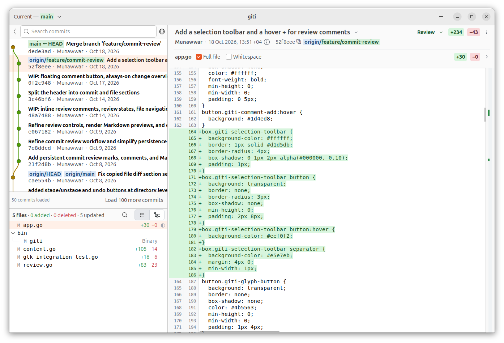

# Giti — a `gitk` alternative

<p align="center">
  
</p>

A fast Git history and diff viewer for Linux, built for switching between the terminal and a graphical review window.



## Features

- Browse commit graphs and local or remote branches without checking them out.
- View staged and unstaged changes; stage, unstage, or undo changes from the file list.
- Search commits, descriptions, references, and file history, including across renames.
- Filter changed files, switch between list and tree views, and browse every file in a commit, the index, or the working tree.
- Search diffs, show line numbers and full-file context, toggle whitespace changes, and inspect merge resolutions.
- Review individual commits: mark files or lines reviewed, add comments, resume saved progress, and preview or export Markdown notes.
- Reuse the background app for quick repeated launches.
- Desktop launcher and Bash, Zsh, and Fish completions.

Saved reviews are cleaned up after 30 days without updates. Export Markdown to keep notes longer.

## Usage

Run from a Git repository:

```sh
giti                         # HEAD
giti main                    # branch, tag, or commit SHA
giti main -- src/            # file or directory history
giti --follow -- README.md   # follow a file across renames
giti --foreground main      # run attached to the terminal
giti -1                      # restart the background app
```

## Installation

Requires GTK 3.24 or newer. The bundled Linux x86_64 binary can be installed without Go:

```sh
./install.sh
```

Choose the bundled binary when prompted, or use `./install.sh --build` to build from source with Go 1.24+ and GTK development files. Use `--system` for a system-wide installation. The default installation is under `~/.local`.

### macOS

Install GTK with [Homebrew](https://brew.sh), then download the Apple Silicon release binary:

```sh
brew install gtk+3 adwaita-icon-theme
mkdir -p ~/.local/bin
curl -fL https://github.com/Munawwar/giti/releases/latest/download/giti-macos-arm64 -o ~/.local/bin/giti
chmod +x ~/.local/bin/giti
```

`./install.sh` does the same and also installs the shell completions. A binary downloaded with a browser instead of `curl` is blocked by Gatekeeper until you run `xattr -d com.apple.quarantine giti`. Releases include `SHA256SUMS` for checking downloads.

To uninstall:

```sh
./uninstall.sh             # user installation
./uninstall.sh --system    # system installation
```

## Debugging

Build with debug symbols and capture crash output:

```sh
./build-debug.sh
GOTRACEBACK=crash bin/giti-debug -f HEAD 2>&1 | tee /tmp/giti-crash.log
```

## License

[GNU General Public License, version 2 or later](LICENSE). The graph layout includes an adaptation of gitg's GPL-licensed implementation.
